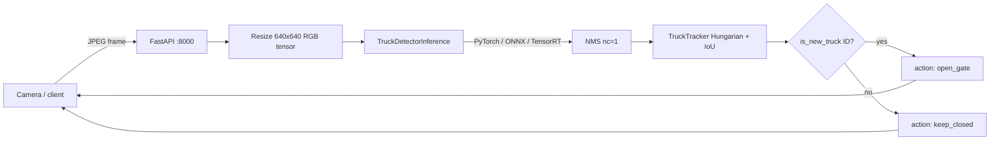
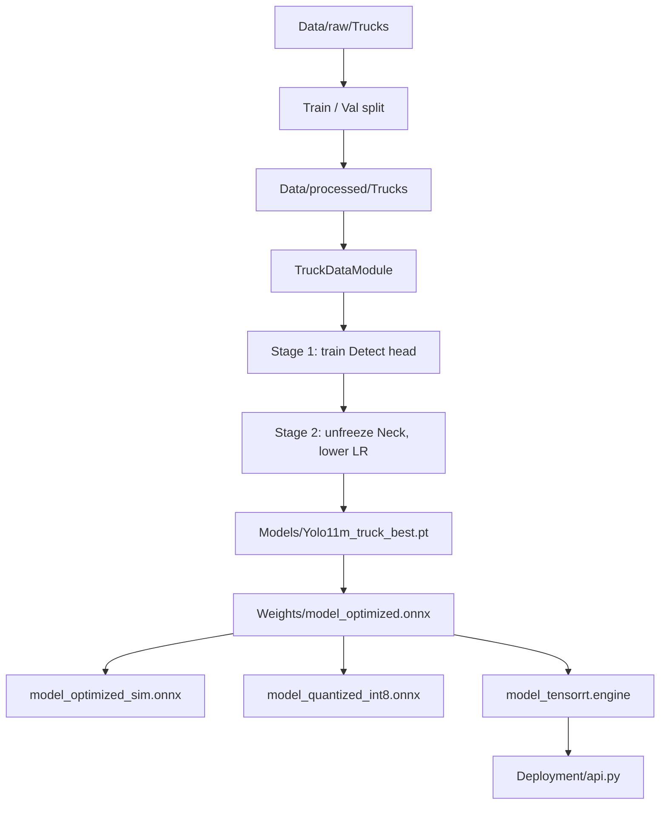

# Smart Gate

**Real-time truck detection and smart-gate control** built as an end-to-end computer vision system: custom YOLO training, model optimization (ONNX / INT8 / TensorRT), multi-object tracking, and a FastAPI service that returns a gate command per camera frame.

---

## Table of contents

1. [Problem](#1-problem)
2. [Solution](#2-solution)
3. [Key features](#3-key-features)
4. [Tech stack](#4-tech-stack)
5. [System architecture](#5-system-architecture)
6. [Full project roadmap](#6-full-project-roadmap)
7. [Repository structure](#7-repository-structure)
8. [Dataset](#8-dataset)
9. [Model and training](#9-model-and-training)
10. [Optimization and export](#10-optimization-and-export)
11. [Tracking and gate logic](#11-tracking-and-gate-logic)
12. [Inference](#12-inference)
13. [API and deployment](#13-api-and-deployment)
14. [Notebooks](#14-notebooks)
15. [How to run](#15-how-to-run)
16. [API contract](#16-api-contract)
17. [GitHub upload notes](#17-github-upload-notes)
18. [Limitations and next steps](#18-limitations-and-next-steps)

---

## 1. Problem

Industrial sites, warehouses, and parking facilities often rely on a human operator or a simple sensor to open a barrier when a truck arrives. That approach is slow, inconsistent, and hard to log.

Smart Gate answers a single operational question for every camera frame:

> Is there a **new** truck in view that has not already triggered the gate?

If yes, the system returns `open_gate`. Otherwise it returns `keep_closed`. Tracking prevents the same truck from opening the gate on every consecutive frame.

---

## 2. Solution

The project is a complete ML pipeline, not only a detector:

| Stage | What it does |
| --- | --- |
| Data | YOLO-format truck images and labels, split into train / val / test |
| Model | Fine-tuned **YOLOv8m** and **YOLO11m** (single class: `truck`) with a frozen-backbone two-stage strategy |
| Optimize | Export to ONNX FP32, simplify, INT8 quantization, TensorRT FP16 engine |
| Track | Custom IoU + Hungarian tracker with a counted-ID set |
| Serve | FastAPI + Uvicorn, optional Docker (CUDA) |
| Consume | Camera / hardware client that posts JPEG frames and reads the gate action |

Production inference is designed around **`Weights/model_tensorrt.engine`**. The same inference layer also loads `.pt` (PyTorch) and `.onnx` (ONNX Runtime).

---

## 3. Key features

- Single-class truck detection at **640×640**
- Two-stage transfer learning (head, then neck + head)
- Mixed-precision training (`16-mixed`) with PyTorch Lightning
- Early stopping and best-checkpoint saving on `val_loss`
- Unified evaluation for PyTorch, ONNX, and TensorRT (precision, recall, F1, mAP@50, mAP@50-95, confusion matrix, latency, file size)
- Image-folder and video inference with overlay (boxes, track IDs, confidence)
- Gate signal printed once per unique truck ID
- REST API: health check + frame processing
- Docker image based on `pytorch/pytorch:2.1.0-cuda11.8-cudnn8-runtime`

---

## 4. Tech stack

| Layer | Libraries |
| --- | --- |
| Detection | Ultralytics YOLO, PyTorch, torchvision |
| Training | Lightning (`TruckDetectionModel`, `TruckDataModule`) |
| Data | PIL, custom YOLO `Dataset`, DataLoader `collate_fn` |
| Tracking | NumPy, SciPy `linear_sum_assignment` |
| Optimization | ONNX, onnxsim, ONNX Runtime quantization, TensorRT |
| Serving | FastAPI, Uvicorn, python-multipart |
| Vision I/O | OpenCV, Matplotlib, Pillow |
| Container | Docker + NVIDIA GPU |

Python dependencies are listed in [`Deployment/requirements.txt`](Deployment/requirements.txt).

---

## 5. System architecture



Training and export path:



---

## 6. Full project roadmap

This is the actual path implemented in the repo, from first data file to a running gate API.

### Phase 0 — Project layout

Python packages under `Src/` (`data`, `models`, `utils`) so notebooks and the API can import the same code. Empty `__init__.py` files make the folders importable. Large artifacts (`Data/`, `Models/`, `Weights/`, videos) are listed in `.gitignore` so GitHub stays small.

### Phase 1 — Data access and exploration

**Notebook:** `Notebooks/data_exploration.ipynb`  
**Code:** `Src/data/data_acess.py`, `Src/utils/visualizer.py`

- Custom `Dataset` pairs each image with a YOLO `.txt` label: `class x_center y_center width height` (normalized 0–1).
- Class `0` is **truck**. Empty labels become empty tensors so images without boxes still load.
- `visualizer.plot_img` draws YOLO boxes on the original image for sanity checks.
- Raw set: **1,741** images and **1,741** labels under `Data/raw/Trucks/`.

### Phase 2 — Split, statistics, DataLoader tuning

Still in `data_exploration.ipynb`, using `Src/data/data_management.py` and `Src/data/data_module.py`.

- Stratified-style `train_test_split` from raw into processed folders.
- Processed counts currently in this workspace:
  - **Train:** 1,566 images + labels
  - **Val:** 175 images + labels
  - **Test:** 240 images (Roboflow-style names under `test/images`, plus saved overlays in `test/images_inference_results`)
- `get_mean_std` computes RGB mean/std (used in DataLoader experiments; the final YOLO pipeline uses resize + ToTensor without ImageNet-style normalize).
- `experiment_best_dataloader_params` benchmarks batch size × `num_workers`.
- `TruckDataModule` (Lightning) builds train / val / test loaders with `pin_memory=True`.

**Train-time augmentation** (`TRAIN_TRANSFORM`):

- Resize 640×640
- ColorJitter (brightness, contrast, saturation, hue)
- GaussianBlur
- Salt-and-pepper noise (`amount=0.01`)
- `ToTensor`

Val / test: resize 640×640 + `ToTensor` only.

### Phase 3 — Architecture choice and freeze strategy

**Notebook:** `Notebooks/model.ipynb`  
**Code:** `Src/models/Build_model.py`

- Inspect **YOLOv8m** and **YOLO11m** (layers, Conv2d count, parameter count, COCO class names).
- Rebuild detection for **`nc=1`**, load compatible pretrained weights, set `names = {0: "truck"}`.
- **Stage 1 freeze:** every layer before `Detect` is frozen; only the head trains.
- Optimizer: **AdamW** on trainable params only, **ReduceLROnPlateau** on `val_loss`.
- Lightning module `TruckDetectionModel`:
  - YOLO criterion via `init_criterion()`
  - Converts dataset targets `{boxes, labels}` into YOLO loss dict `{batch_idx, cls, bboxes}`
  - Validation temporarily switches the inner model to train mode so the detection loss is computed correctly, then returns to eval

### Phase 4 — Two-stage training

**Code:** `Src/models/train.py`

`run_two_stage_training`:

| Stage | What is trainable | Precision | Notes |
| --- | --- | --- | --- |
| 1 | Detect head only | `16-mixed` | Backbone + neck frozen |
| 2 | Neck + head | `16-mixed` | Backbone stays frozen; LR × 0.1; `unfreeze_neck()` finds first `Upsample` as backbone end |

Callbacks:

- `early_stopping`: monitor `val_loss`, patience = 50% of configured epochs, `mode=min`
- `PerformanceCallback`: logs train/val loss, tracks peak GPU memory, saves `{model_name}_best.pt` with `model_state_dict`, optimizer, epoch, `val_loss`

Checkpoints in this project:

- `Models/Yolo11m_truck_best.pt` (primary)
- `Models/YOLOv8m_truck_best.pt`

Typical notebook settings: `batch_size=16`, `num_workers=2`, GPU required for realistic training.

### Phase 5 — Export and acceleration

**Code:** `Src/models/optimize.py`  
**Artifacts:** `Weights/`

1. **ONNX FP32** — `export_to_onnx`: dummy input `(1, 3, 640, 640)`, opset 11, dynamic batch, `input_names=['images']`.
2. **Simplify** — onnxsim → `model_optimized_sim.onnx`.
3. **INT8 static quantization** — calibration on 10 validation batches, QDQ, quantize Conv / MatMul / Add / Mul → `model_quantized_int8.onnx`.
4. **TensorRT FP16** — parse ONNX, workspace 2 GB, optimization profile batch 1–8, serialize → `model_tensorrt.engine`.

The `.engine` file is **GPU-architecture specific**. Rebuild it on the target NVIDIA card; do not copy an engine from Colab to a different GPU and expect it to load.

### Phase 6 — Evaluation

**Notebook:** `Notebooks/evaluate_model.ipynb`  
**Code:** `Src/models/evaluate.py`, `Src/utils/metrics.py`

`per_class_acc_and_conf_matrix` accepts a Lightning/PyTorch model **or** a path ending in `.onnx` / `.engine`. It reports:

- TP / FP / FN
- Precision, recall, F1
- mAP@50 and mAP@50-95 (`ultralytics.utils.metrics.ap_per_class`)
- Confusion heatmap (background vs truck)
- File size (`get_model_size_mb`)
- Average latency in ms (`measure_inference_time`, warmup + 100 iterations)

`metrics.visualize_predictions_range` overlays **green ground truth** vs **red predictions** on a val index range.

`SimpleTRTBackend` wraps TensorRT 8 and TensorRT 10+ IO APIs.

### Phase 7 — Offline inference

**Code:** `Src/models/inference.py`

`TruckDetectorInference`:

- Detects backend from extension: `.onnx` → ONNX Runtime, `.engine` → TensorRT, otherwise PyTorch
- Shared preprocess: RGB, 640×640, ToTensor
- NMS: `conf_threshold`, `iou_threshold`, `nc=1`
- Scales boxes from 640 back to original resolution

Helpers:

- `run_inference_on_folder` — unlabeled images → `pred_*.jpg`
- `run_inference_on_video` — detection + tracking + overlay + unique-truck count

Demo video path used in the notebook: `Data/processed/Trucks/test/video/14610581_2160_3840_24fps.mp4` → `Data/result_video.mp4`.

### Phase 8 — Tracking and gate policy

**Code:** `Src/models/tracker.py`

Custom tracker (no ByteTrack / DeepSORT dependency):

- Match previous boxes to new detections with an **IoU cost matrix** and the **Hungarian algorithm**
- Unmatched detections become new IDs
- Tracks persist up to `track_buffer` (default 30) disappeared frames
- `is_new_truck(track_id)` returns `True` only the first time that ID is seen (`counted_trucks` set)

This is the gate policy: **open once per unique truck**, not once per frame.

### Phase 9 — API

**Code:** `Deployment/api.py`

On startup (lifespan):

- Load TensorRT engine from `Weights/model_tensorrt.engine`
- Create `TruckTracker(track_thresh=0.45, frame_rate=10)`
- Detector confidence **0.45**

Endpoints:

| Method | Path | Role |
| --- | --- | --- |
| GET | `/health` | Liveness |
| POST | `/api/v1/process_frame` | Multipart image → JSON gate decision |

Default bind: `0.0.0.0:8000`.

### Phase 10 — Client, tests, Docker

- `Deployment/client_camera.py` — posts one or more JPEGs and prints `OPENING GATE` vs `KEEP GATE CLOSED`.
- `Notebooks/evaluate_model.ipynb` — TestClient, background Uvicorn, live HTTP call, client simulation, Docker build/run comments.
- `Deployment/Dockerfile` — CUDA 11.8 runtime, install `requirements.txt`, copy `Src/`, `Weights/`, `Deployment/`, run Uvicorn.
- `Tests/test_data.py` and `Tests/test_model.py` exist as placeholders (currently empty).

---

## 7. Repository structure

```text
Smart Gate/
├── README.md
├── .gitignore
├── Configs/
│   └── config.yaml           # Reserved configuration file
├── Data/                     # Gitignored (too large)
│   ├── raw/Trucks/{images,labels}
│   ├── processed/Trucks/{train,val,test}
│   └── result_video.mp4
├── Models/                   # Gitignored checkpoints
│   ├── Yolo11m_truck_best.pt
│   └── YOLOv8m_truck_best.pt
├── Weights/                  # Gitignored exported graphs
│   ├── model_optimized.onnx
│   ├── model_optimized.onnx.data
│   ├── model_optimized_sim.onnx
│   ├── model_quantized_int8.onnx
│   └── model_tensorrt.engine
├── Notebooks/
│   ├── data_exploration.ipynb
│   ├── model.ipynb
│   └── evaluate_model.ipynb
├── Src/
│   ├── data/
│   │   ├── data_acess.py         # YOLO Dataset
│   │   ├── data_module.py        # Lightning DataModule + augmentations
│   │   └── data_management.py    # mean/std, DataLoader benchmarks
│   ├── models/
│   │   ├── Build_model.py        # YOLO freeze, Lightning module
│   │   ├── train.py              # Two-stage trainer + callbacks
│   │   ├── optimize.py           # ONNX / INT8 / TensorRT
│   │   ├── evaluate.py           # Metrics + TRT backend
│   │   ├── inference.py          # Images, video, multi-backend
│   │   └── tracker.py            # IoU tracker + gate IDs
│   └── utils/
│       ├── visualizer.py         # Dataset plots, loader timing
│       └── metrics.py            # Pred vs GT visualization
├── Deployment/
│   ├── api.py
│   ├── client_camera.py
│   ├── requirements.txt
│   ├── Dockerfile
│   └── .dockerignore
└── Tests/
    ├── test_data.py
    └── test_model.py
```

---

## 8. Dataset

| Split | Location | Images | Labels | Role |
| --- | --- | --- | --- | --- |
| Raw | `Data/raw/Trucks` | 1,741 | 1,741 | Source annotations |
| Train | `Data/processed/Trucks/train` | 1,566 | 1,566 | Learning |
| Val | `Data/processed/Trucks/val` | 175 | 175 | Loss, mAP, calibration |
| Test | `Data/processed/Trucks/test/images` | 240 | — | Unlabeled / Roboflow visual test |

Label format (example):

```text
0 0.512846 0.409844 0.948459 0.631543
0 0.715282 0.344537 0.569435 0.496090
```

`0` = truck. Remaining values are YOLO normalized `cx cy w h`. Multiple lines = multiple trucks.

---

## 9. Model and training

**Task:** object detection, one class.

**Backbones compared:** YOLOv8 medium and YOLO11 medium (Ultralytics). Fine-tuning keeps the backbone as a frozen feature extractor for most of training to reduce overfitting on a modest truck dataset.

**Loss:** Ultralytics detection criterion (box + class + DFL components aggregated to a scalar, then averaged by batch size).

**Hardware assumption:** NVIDIA GPU. TensorRT and mixed precision are not optional for the production path.

---

## 10. Optimization and export

| Artifact | Precision | Typical use |
| --- | --- | --- |
| `Yolo11m_truck_best.pt` | FP16/FP32 training checkpoint | Retrain, export |
| `model_optimized.onnx` | FP32 | Portable graph |
| `model_optimized_sim.onnx` | FP32 simplified | Cleaner ONNX |
| `model_quantized_int8.onnx` | INT8 | Smaller CPU/edge graph |
| `model_tensorrt.engine` | FP16 (if supported) | **API runtime** |

Always compare accuracy **and** latency after each export. INT8 can drop mAP; TensorRT should stay close to PyTorch if the engine is built on the same GPU family.

---

## 11. Tracking and gate logic

Output of `TruckTracker.update`: rows of

`[x1, y1, x2, y2, track_id, confidence, class_id]`

in **640-space**. The API and video overlay scale boxes to the original frame size.

Gate rule in `api.py`:

1. Run detector.
2. Update tracker.
3. For each visible ID, call `is_new_truck`.
4. If any ID is new → `"action": "open_gate"`.
5. Else → `"action": "keep_closed"`.

Response also includes `trucks_in_frame` and per-truck `track_id`, `confidence`, `bbox`.

---

## 12. Inference

```python
from Src.models.inference import run_inference_on_folder, run_inference_on_video

run_inference_on_folder(
    model_path="Weights/model_tensorrt.engine",
    input_folder="Data/processed/Trucks/test/images",
    output_folder="Data/processed/Trucks/test/images_inference_results",
    conf_thresh=0.40,
)

run_inference_on_video(
    model_path="Weights/model_tensorrt.engine",
    input_video_path="Data/processed/Trucks/test/video/input.mp4",
    output_video_path="Data/result_video.mp4",
    conf_thresh=0.45,
)
```

---

## 13. API and deployment

The server loads the model **once** at process start. Do not instantiate YOLO inside the request handler.

**Important Docker note:** `Deployment/.dockerignore` currently excludes `Weights/`. `Dockerfile` still `COPY Weights/`. When you build, either remove `Weights/` from `.dockerignore` or mount the engine at runtime:

```bash
docker run --gpus all -p 8000:8000 \
  -v "%CD%/Weights:/app/Weights" \
  --name smart-gate-app smart-gate-api
```

Without a valid `.engine` (or a code change to load ONNX/PyTorch), `/api/v1/process_frame` will fail at startup.

---

## 14. Notebooks

| Notebook | Purpose |
| --- | --- |
| `Notebooks/data_exploration.ipynb` | Drive mount, dataset load, split, mean/std, DataLoader experiment, DataModule check |
| `Notebooks/model.ipynb` | Inspect YOLO, freeze strategy, two-stage train, ONNX, INT8, simplify, repo hygiene |
| `Notebooks/evaluate_model.ipynb` | Compare PyTorch / ONNX / INT8 / TensorRT, image & video inference, API, client, Docker |

Notebooks were developed on **Google Colab** with paths like `/content/drive/MyDrive/Smart Gate/...`. On a local machine, point those paths at this repository root.

---

## 15. How to run

### 15.1 Environment

```bash
python -m venv .venv
.venv\Scripts\activate
pip install -r Deployment/requirements.txt
```

NVIDIA GPU + matching CUDA is required for TensorRT and `onnxruntime-gpu`.

### 15.2 Train (from a notebook or script)

1. Prepare `Data/processed/Trucks/{train,val,test}`.
2. Run `Notebooks/model.ipynb` (or call `train.run_two_stage_training`).
3. Best weights land in `Models/`.

### 15.3 Export

Use `optimize.export_to_onnx`, optional `apply_static_quantization`, then `export_onnx_to_tensorrt` **on the GPU that will serve the API**.

### 15.4 API (local)

From the **repository root**:

```bash
python Deployment/api.py
```

Health check: `http://localhost:8000/health`

### 15.5 Client

Edit the image path in `Deployment/client_camera.py`, then:

```bash
python Deployment/client_camera.py
```

### 15.6 Docker

From the repository root:

```bash
docker build -t smart-gate-api -f Deployment/Dockerfile .
docker run -d -p 8000:8000 --gpus all --name smart-gate-app smart-gate-api
```

---

## 16. API contract

### `GET /health`

```json
{
  "status": "ok",
  "message": "Smart Gate API is running smoothly!"
}
```

### `POST /api/v1/process_frame`

- Body: `multipart/form-data` field `file` (image)
- `400` if the upload is not an image
- `500` on decode/inference errors

Success:

```json
{
  "status": "success",
  "action": "open_gate",
  "trucks_in_frame": 1,
  "details": [
    {
      "track_id": 1,
      "confidence": 0.91,
      "bbox": [12.0, 40.0, 400.0, 380.0]
    }
  ]
}
```

`action` is `"open_gate"` or `"keep_closed"`. Sending the **same** truck again should keep the gate closed after the ID is counted.

---

## 17. GitHub upload notes

Already ignored (see `.gitignore`):

- `Data/`, `Models/`, `Weights/`
- `*.pt`, `*.onnx`, `*.engine`, `*.mp4`
- `__pycache__/`, notebooks checkpoints, IDE folders

**Do commit:** `Src/`, `Deployment/` (code + Dockerfile + requirements), `Notebooks/`, `Configs/`, `Tests/`, `README.md`, `.gitignore`.

**Do not commit** datasets or engines. Host weights on Drive, Hugging Face, or GitHub Releases, and document the download path. If you need a public demo, export a small ONNX and document CPU fallback.

Suggested first commit message:

```text
Add Smart Gate truck detection pipeline, tracking API, and documentation
```

---

## 18. Limitations and next steps

- `Configs/config.yaml` is reserved but empty; paths and hyperparameters currently live in notebooks.
- `Tests/` are placeholders — add pytest coverage for Dataset, tracker ID assignment, and API `TestClient`.
- Tracker is IoU-only (no appearance embedding); heavy occlusion can swap IDs.
- Gate logic is ID-based, not a physical line-crossing / ROI trigger.
- TensorRT engines are not portable across GPU architectures.
- `.dockerignore` vs `COPY Weights/` mismatch (see [API and deployment](#13-api-and-deployment)).
- `client_camera.py` still contains a Colab image path; change it before local demo.

Useful follow-ups: ROI line at the barrier, logging to a database, authentication on the API, TensorRT engine build as a documented CI/GPU job, and filling `config.yaml` as the single source of paths and thresholds.

---

## License

Add a license file of your choice (MIT, Apache-2.0, etc.) before making the repository public.
